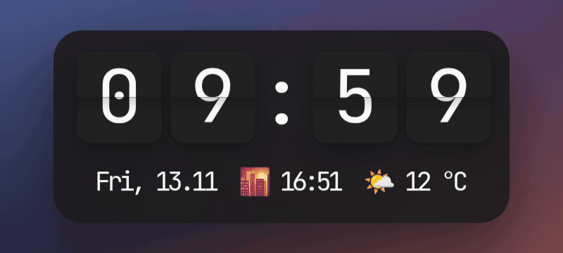
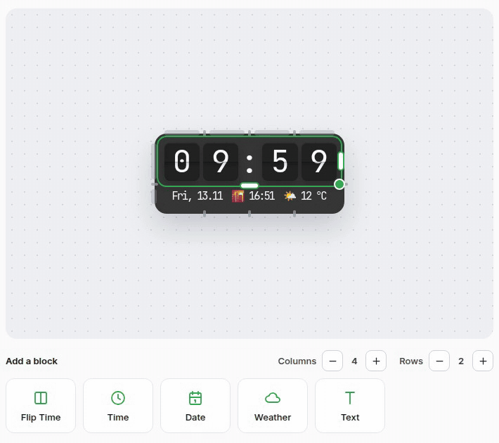
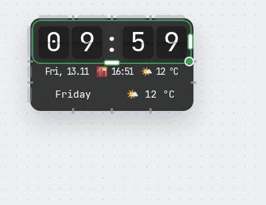
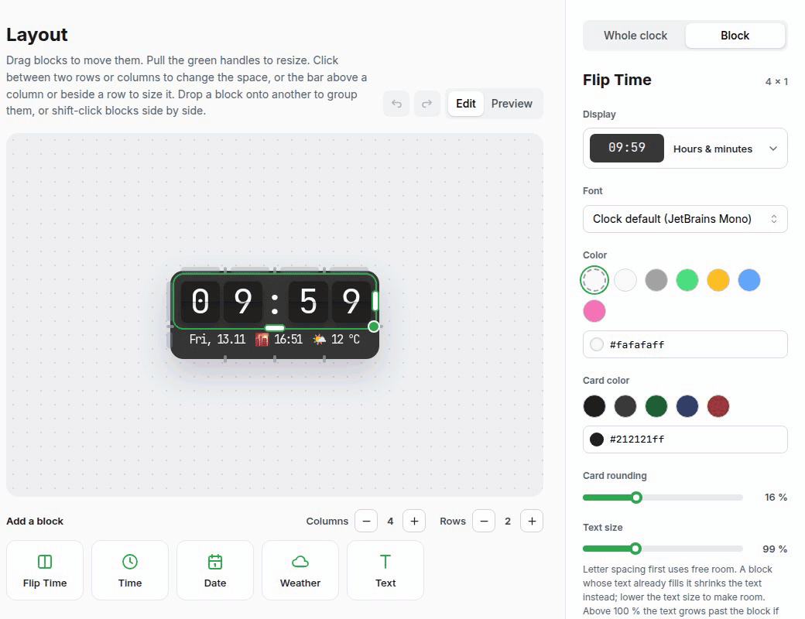
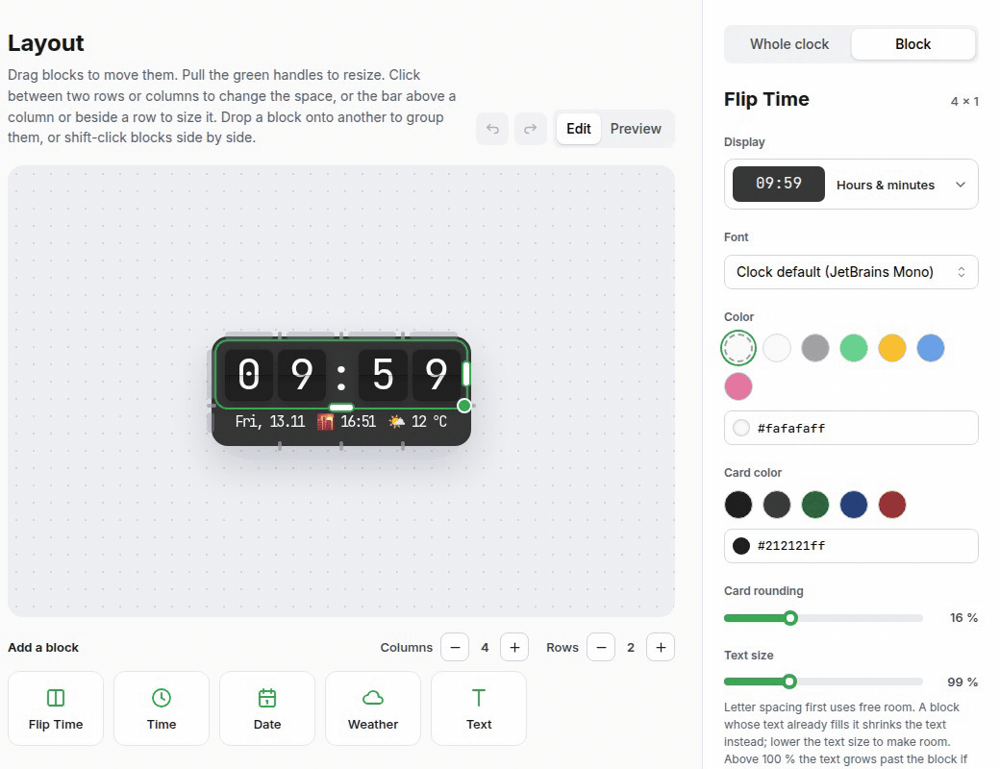
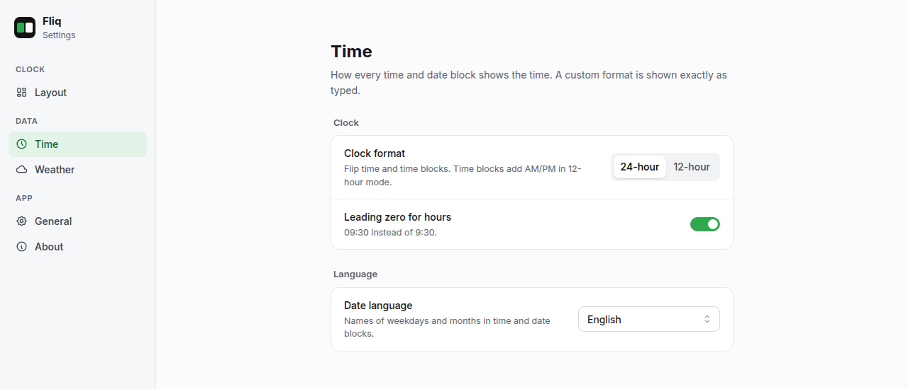

# Fliq – A Floating Desktop Flipclock ⏳


https://github.com/user-attachments/assets/6796d331-4cf8-4b79-a32d-208d5bc32768


---

## Installation 💻

Every command below downloads the newest release straight from GitHub and installs it.

### Linux 🐧

**Fedora / RHEL / Nobara** (`.rpm`)

```bash
sudo dnf install "$(curl -s https://api.github.com/repos/Dav1d-Fn/Fliq-Desktop-Flipclock/releases/latest | grep -o 'https://[^"]*x86_64\.rpm' | head -n1)"
```

**openSUSE** (`.rpm`, the package is not signed)

```bash
sudo zypper install --allow-unsigned-rpm "$(curl -s https://api.github.com/repos/Dav1d-Fn/Fliq-Desktop-Flipclock/releases/latest | grep -o 'https://[^"]*x86_64\.rpm' | head -n1)"
```

**Debian / Ubuntu / Mint / Pop!_OS** (`.deb`)

```bash
curl -sLo /tmp/fliq.deb "$(curl -s https://api.github.com/repos/Dav1d-Fn/Fliq-Desktop-Flipclock/releases/latest | grep -o 'https://[^"]*amd64\.deb' | head -n1)" && sudo apt install /tmp/fliq.deb
```

**Arch / Manjaro / anything else:** there is no AUR package or Flatpak yet —
[build from source](#building-from-source).

Packages are built for x86_64 only. To update, run the same command again.

### Windows 🪟

Download and run the latest installer in PowerShell:

```powershell
$url = ((irm https://api.github.com/repos/Dav1d-Fn/Fliq-Desktop-Flipclock/releases/latest).assets | ? name -like '*x64-setup.exe').browser_download_url; iwr $url -OutFile "$env:TEMP\fliq-setup.exe"; & "$env:TEMP\fliq-setup.exe"
```

Or grab the `.exe` (or `.msi`) by hand from the [Releases](https://github.com/Dav1d-Fn/Fliq-Desktop-Flipclock/releases/latest) page.

### macOS 🍎

Not available — there is no Mac to build or test on.

---

## Overview 📋

**Fliq** is a sleek, customizable desktop clock that displays the current time in a retro flip clock style.  
Built with [React](https://reactjs.org/) and [Tauri v2](https://v2.tauri.app/), it's fast, lightweight, and privacy-friendly.

The clock is a small grid of **blocks** — flip time, time, date, weather or your own text — that
you arrange like widgets on a phone home screen.

<div align="center">
  
</div>

---

## Features ✨

### 🧩 Grid Layout Editor

Right-click the clock and pick **Styling** to open the settings. The **Layout** page shows the real
clock on a grid:

- **Blocks:** Flip Time, Time, Date, Weather and Text. Click a tile to add one; it lands on the
  first free spot.
- **Drag & drop** blocks to move them, pull the green handles to resize them.
- **More room:** add or remove columns (up to 8) and rows (up to 4).

<div align="center">
  
</div>

### 🔗 Groups

Drop a block **onto another block** and both become one group: they share one line and one look,
like *date · sunset · temperature* under the flip cards. Shift-click blocks side by side to group
them, too. **Right-click** a member of a group to move it left or right, open its settings, or take
it out of the group again.

<div align="center">
  
</div>

### 🎛️ Settings for Every Block

Select a block and the inspector on the right shows what it can do:

- What it shows (e.g. hours & minutes or with seconds, weekday & date, temperature, next sunrise / sunset), or a custom format
- Font, color, alignment, card color and rounding for flip cards
- **Own background** with its own color and rounding
- **Letter spacing**, **text size** and padding
- **Offset** to nudge a block freely, off the grid

The **Whole clock** tab holds what all blocks share: size on the desktop, background, corner
rounding, padding, column width, row height and the space between columns and rows.

<div align="center">
  
</div>

### 📐 Column & Row Sizes, Gaps, Undo

Click the bar above a column or beside a row to size just that one, or click between two rows or
columns to change that single gap. Every change can be undone and redone (**Ctrl+Z** /
**Ctrl+Shift+Z** or the arrows above the canvas), and **Preview** shows the clock without the
editing aids.

<div align="center">
  
</div>

### 🕒 Data › Time

- **12- or 24-hour** clock for all flip time and time blocks (time blocks add AM/PM)
- **Leading zero** for hours (09:30 or 9:30)
- **Date language** for weekday and month names: English, Deutsch, Français, Español, Italiano,
  Русский, 中文, 日本語, Svenska, Polski. Don't see your language? [Open an issue](https://github.com/Dav1d-Fn/Fliq-Desktop-Flipclock/issues) or contribute a translation – it's always welcome!

<div align="center">
  
</div>

### 🌤️ Weather & Sun Data

- Live weather via [wttr.in](https://wttr.in) — temperature, condition, feels like, high & low
- Next sunrise or sunset via [sunrise-sunset.org](https://sunrise-sunset.org/api)
- Location by city name or detected automatically, °C or °F
- Updates every 15 minutes in the background, no API key needed

### 🐧 tuxhub Integration

On Linux, Fliq offers its settings live to [tuxhub](https://github.com/SirSnolte/tuxhub): while
both run, tuxhub shows Fliq's whole-clock settings, time, weather and window options as a page of
its own and changes apply right away.

### ⚙️ Window Settings

- Autostart on system boot
- Hide from taskbar
- Always-on-top toggle
- Reset all settings

Coming from an older version with template tags (`$FLIPTIME(HH:mm)` …)? Your two rows are turned
into blocks automatically on the first start.

---

## Linux Notes 🐧

### Why there is no AppImage

There is deliberately no `.AppImage`. An AppImage carries its own GTK and WebKitGTK, which then
collide with the host's Mesa and freetype — on Fedora 44 the renderer aborts with
`EGL_BAD_PARAMETER` before the clock is ever drawn. It also forces `GDK_BACKEND=x11`, which rules
out layer-shell and with it the above-fullscreen behaviour that is the whole point of the Wayland
path.

### What works where

Wayland does not let an application keep itself on top by itself. Fliq therefore picks one
of two modes at startup, and what you get depends on your desktop:

| Desktop | Frameless & transparent | Above normal windows | Above fullscreen games |
|---|---|---|---|
| KDE Plasma (Wayland) | ✅ | ✅ | ✅ |
| Sway / Hyprland | ✅ | ✅ | ✅ |
| GNOME (Wayland) | ✅ | ✅ | ❌ |
| Any X11 session | ✅ | ✅ | ❌ |

Above fullscreen requires the `wlr-layer-shell` protocol, which KDE Plasma, Sway, Hyprland and
other wlroots-based compositors implement. **GNOME does not implement it and has stated it will
not**, so on GNOME — and on any X11 session — the clock stays above normal windows but not
above fullscreen ones.

A few other things worth knowing:

- **Dragging on Wayland** feels less smooth than dragging a normal window. The drag outline is
  drawn by a webview whose frame clock is capped at ~62 Hz regardless of the monitor's refresh
  rate (measured: 164.87 Hz on the test machine), and the position travels through the app
  instead of being handled by the compositor directly. This is a property of WebKitGTK, not a
  misconfiguration — it can't be fixed from the application.
- **Multi-monitor:** the clock can be dragged to any monitor. The drag outline itself is only
  drawn on up to **8 monitors** — beyond that, dragging still works, just without a preview on
  the extra screens. A monitor plugged in while Fliq is already running gets no outline until
  restart.
- **X11 compatibility mode** has no drag outline at all — dragging is handled by the window
  manager directly, same as on Windows.
- If auto-detection picks the wrong mode, override it under **Styling → General →
  Overlay mode** (takes effect after a restart).

Only **KDE Plasma 6.7.3 on Wayland** has actually been tested. GNOME, XFCE, Cinnamon, Sway,
Hyprland, X11 sessions, and every distro other than Fedora are expected to work but untested.
If something's broken on your setup, please [open an issue](https://github.com/Dav1d-Fn/Fliq-Desktop-Flipclock/issues)
with your desktop and distro.

### Building from source

```bash
# Fedora
sudo dnf install webkit2gtk4.1-devel gtk3-devel gtk-layer-shell-devel libappindicator-gtk3-devel librsvg2-devel patchelf

# Debian / Ubuntu
sudo apt install libwebkit2gtk-4.1-dev libgtk-3-dev libgtk-layer-shell-dev libayatana-appindicator3-dev librsvg2-dev patchelf

npm install
npm run tauri build
```

---

## Dependencies 📦

Fliq is built on the shoulders of great open-source projects:

- [pqina/flip](https://github.com/pqina/flip) – Lightweight JavaScript flip animations.
- [Day.js](https://github.com/iamkun/dayjs) – Fast, modern alternative to Moment.js.
- [Mantine](https://github.com/mantinedev/mantine) – Modern React UI components.
- [Jotai](https://github.com/pmndrs/jotai) – Minimalist global state management.
- [wttr.in](https://github.com/chubin/wttr.in) – Weather data via HTTP (no API key required).
- [sunrise-sunset.org](https://sunrise-sunset.org/api) – Free sunrise & sunset time API.
- [Tabler Icons](https://github.com/tabler/tabler-icons) – Icons in the settings window.
- [Inter](https://rsms.me/inter/) & [JetBrains Mono](https://www.jetbrains.com/lp/mono/) – Bundled fonts via [Fontsource](https://fontsource.org/).

---

## Upcoming Updates 🛠️

Here’s a glimpse at what’s coming:

- ~~🐧 **Linux Support**~~ — done
- ~~🍎 **macOS Support**~~ — no Mac to build or test on, don't count on this happening
- ~~🎨 **Additional Clock Styles** and layouts~~ — done, see the grid layout editor
- 📅 **Calendar Integration** – events & reminders
- ✅ **Task Support** – simple to-dos directly on the clock

---

## Donations 💖

If you enjoy using Fliq and want to support its development, you can buy me a coffee:

[](https://ko-fi.com/davidfn)

---

## Feedback & Contributions

Found a bug or have a feature idea?  
Feel free to [open an issue](https://github.com/Dav1d-Fn/Fliq-Desktop-Flipclock/issues) or reach out!

---

Thank you for using Fliq 🙌 
